# NPC Union

<p align="center">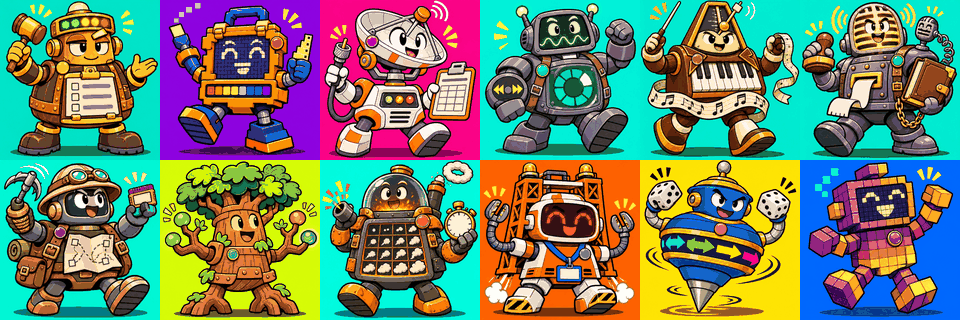</p>

NPC Union is a Claude Code plugin that adds a crew of game-development specialist agents: design, art, 3D, UI and effects, sound, narrative, programming, engines, multiplayer, AI integration, MCP, asset scouting, production, genres, art styles, and subject domains such as space science and healthcare.

You talk to one orchestrator, the **Shop Steward**. It picks the specialists a request needs, runs them, and returns one answer that credits who said what. You can also talk to any specialist directly.

## Install

In Claude Code:

```
/plugin marketplace add MaanasEgamamidi/npc-union
/plugin install npc-union@npc-union
```

Then start a session with the Steward:

```bash
claude --agent npc-union:leadership:shop-steward
```

Not using the plugin system? `install.sh` (macOS, Linux) and `install.ps1` (Windows) copy the agents into a project's `.claude/` or your `~/.claude/`. See [CONTRIBUTING.md](CONTRIBUTING.md) for running from a clone.

## Example

```
> /npc-union:steward I want a pixel-art metroidvania in Godot. Where do I start?

Shop Steward: Three people on this one. Summary first, then who said what.

1. Lock the ability-gate graph before drawing a single room. (metroidvania-expert)
2. Pick a base resolution and tile size now; changing them later means redrawing
   every tileset. Scale by whole numbers only. (pixel-art-stylist)
3. Check the current Godot release before setting up the project, and turn on
   pixel snapping in project settings. (godot-specialist, version looked up
   from the official docs)

Next step: game-designer drafts the core loop. Want me to run it?
```

Useful commands:

| Command | What it does |
|---|---|
| `/npc-union:steward` | Bring in the Shop Steward |
| `/npc-union:talk <agent>` | Talk to one specialist in character |
| `/npc-union:route` | Ask who should handle a request |
| `/npc-union:roster` | Browse agents by folder, capability, or runtime |
| `/npc-union:build-pipeline <idea>` | Get a written plan of which agents run in which order |
| `/npc-union:kb <query>` | Search the knowledge base |
| `/npc-union:new-specialist <topic>` | Generate a new specialist agent |

## How it works

- Agents live in `agents/<division>/<department>/<name>.md` and register as `npc-union:<division>:<department>:<name>`.
- The Steward hands cross-department work to a division lead, who runs their specialists and reports back.
- Each agent has a `runtime`. `claude` agents run as Claude Code subagents. `codex` agents (those that depend on live web search or image generation) run through `scripts/run-agent.mjs` and fall back to Claude if Codex is not installed.
- Knowledge files in `knowledge/` carry sources and a `last_verified` date. Agents look up version-specific facts instead of recalling them.

More detail: [docs/HOW-IT-WORKS.md](docs/HOW-IT-WORKS.md) and [docs/PIPELINE.md](docs/PIPELINE.md).

## Roster

Generated from `catalog/roster.json`.


### leadership

| Agent | Plugin ID | Runtime | Model |
|---|---|---|---|
| shop-steward | `npc-union:leadership:shop-steward` | claude | opus |
| creative-lead | `npc-union:leadership:creative-lead` | claude | opus |
| technical-lead | `npc-union:leadership:technical-lead` | claude | opus |
| production-lead | `npc-union:leadership:production-lead` | claude | opus |
| knowledge-lead | `npc-union:leadership:knowledge-lead` | claude | sonnet |

### production

| Agent | Plugin ID | Runtime | Model |
|---|---|---|---|
| producer | `npc-union:production:producer` | claude | sonnet |
| prototyper | `npc-union:production:prototyper` | claude | sonnet |
| qa-lead | `npc-union:production:qa-lead` | claude | sonnet |
| qa-tester | `npc-union:production:qa-tester` | claude | sonnet |
| playtest-analyst | `npc-union:production:playtest-analyst` | claude | sonnet |
| accessibility-specialist | `npc-union:production:accessibility-specialist` | claude | sonnet |
| release-manager | `npc-union:production:release-manager` | claude | sonnet |
| live-ops-designer | `npc-union:production:live-ops-designer` | claude | sonnet |
| analytics-engineer | `npc-union:production:analytics-engineer` | claude | sonnet |
| community-manager | `npc-union:production:community-manager` | codex | sonnet |
| store-page-marketer | `npc-union:production:store-page-marketer` | codex | sonnet |
| monetization-designer | `npc-union:production:monetization-designer` | claude | sonnet |
| game-legal-advisor | `npc-union:production:game-legal-advisor` | codex | opus |

### creative/design

| Agent | Plugin ID | Runtime | Model |
|---|---|---|---|
| brief-keeper | `npc-union:creative:design:brief-keeper` | claude | sonnet |
| game-designer | `npc-union:creative:design:game-designer` | claude | opus |
| controls-designer | `npc-union:creative:design:controls-designer` | claude | sonnet |
| world-builder | `npc-union:creative:design:world-builder` | claude | opus |
| character-designer | `npc-union:creative:design:character-designer` | claude | sonnet |
| moodboard-curator | `npc-union:creative:design:moodboard-curator` | codex | sonnet |
| level-designer | `npc-union:creative:design:level-designer` | claude | sonnet |
| systems-designer | `npc-union:creative:design:systems-designer` | claude | opus |
| economy-designer | `npc-union:creative:design:economy-designer` | claude | sonnet |
| ux-designer | `npc-union:creative:design:ux-designer` | claude | sonnet |
| npc-designer | `npc-union:creative:design:npc-designer` | claude | opus |
| quest-designer | `npc-union:creative:design:quest-designer` | claude | sonnet |

### creative/art

| Agent | Plugin ID | Runtime | Model |
|---|---|---|---|
| art-director | `npc-union:creative:art:art-director` | claude | opus |
| concept-artist | `npc-union:creative:art:concept-artist` | codex | sonnet |
| sprite-artist | `npc-union:creative:art:sprite-artist` | codex | sonnet |
| anime-artist | `npc-union:creative:art:anime-artist` | codex | sonnet |
| pose-artist | `npc-union:creative:art:pose-artist` | codex | sonnet |
| animator | `npc-union:creative:art:animator` | claude | sonnet |
| vector-artist | `npc-union:creative:art:vector-artist` | codex | sonnet |
| texture-artist | `npc-union:creative:art:texture-artist` | codex | sonnet |
| layer-compositor | `npc-union:creative:art:layer-compositor` | codex | sonnet |
| environment-artist | `npc-union:creative:art:environment-artist` | codex | sonnet |
| modeler-3d | `npc-union:creative:art:modeler-3d` | codex | sonnet |

### creative/screens-effects

| Agent | Plugin ID | Runtime | Model |
|---|---|---|---|
| logo-designer | `npc-union:creative:screens-effects:logo-designer` | codex | sonnet |
| title-screen-designer | `npc-union:creative:screens-effects:title-screen-designer` | codex | sonnet |
| game-ui-artist | `npc-union:creative:screens-effects:game-ui-artist` | codex | sonnet |
| shader-artist | `npc-union:creative:screens-effects:shader-artist` | claude | opus |
| vfx-artist | `npc-union:creative:screens-effects:vfx-artist` | claude | sonnet |
| video-director | `npc-union:creative:screens-effects:video-director` | codex | sonnet |

### creative/sound

| Agent | Plugin ID | Runtime | Model |
|---|---|---|---|
| audio-director | `npc-union:creative:sound:audio-director` | claude | sonnet |
| composer | `npc-union:creative:sound:composer` | claude | sonnet |
| sfx-designer | `npc-union:creative:sound:sfx-designer` | claude | sonnet |
| chiptune-synthesist | `npc-union:creative:sound:chiptune-synthesist` | claude | sonnet |
| voice-director | `npc-union:creative:sound:voice-director` | claude | sonnet |

### creative/narrative

| Agent | Plugin ID | Runtime | Model |
|---|---|---|---|
| narrative-director | `npc-union:creative:narrative:narrative-director` | claude | opus |
| dialogue-writer | `npc-union:creative:narrative:dialogue-writer` | claude | opus |
| lore-keeper | `npc-union:creative:narrative:lore-keeper` | claude | sonnet |
| localization-lead | `npc-union:creative:narrative:localization-lead` | claude | sonnet |

### technical/programming

| Agent | Plugin ID | Runtime | Model |
|---|---|---|---|
| technical-director | `npc-union:technical:programming:technical-director` | claude | opus |
| gameplay-programmer | `npc-union:technical:programming:gameplay-programmer` | claude | opus |
| engine-programmer | `npc-union:technical:programming:engine-programmer` | claude | opus |
| graphics-programmer | `npc-union:technical:programming:graphics-programmer` | claude | opus |
| physics-programmer | `npc-union:technical:programming:physics-programmer` | claude | opus |
| ui-programmer | `npc-union:technical:programming:ui-programmer` | claude | sonnet |
| tools-programmer | `npc-union:technical:programming:tools-programmer` | claude | sonnet |
| technical-artist | `npc-union:technical:programming:technical-artist` | claude | sonnet |
| performance-engineer | `npc-union:technical:programming:performance-engineer` | claude | opus |
| build-engineer | `npc-union:technical:programming:build-engineer` | claude | sonnet |
| save-systems-engineer | `npc-union:technical:programming:save-systems-engineer` | claude | sonnet |

### technical/engines

| Agent | Plugin ID | Runtime | Model |
|---|---|---|---|
| web-engine-specialist | `npc-union:technical:engines:web-engine-specialist` | claude | opus |
| godot-specialist | `npc-union:technical:engines:godot-specialist` | claude | opus |
| unity-specialist | `npc-union:technical:engines:unity-specialist` | claude | opus |
| unreal-specialist | `npc-union:technical:engines:unreal-specialist` | claude | opus |
| gamemaker-specialist | `npc-union:technical:engines:gamemaker-specialist` | claude | sonnet |
| roblox-specialist | `npc-union:technical:engines:roblox-specialist` | claude | sonnet |
| bevy-specialist | `npc-union:technical:engines:bevy-specialist` | claude | sonnet |

### technical/multiplayer

| Agent | Plugin ID | Runtime | Model |
|---|---|---|---|
| netcode-architect | `npc-union:technical:multiplayer:netcode-architect` | claude | opus |
| multiplayer-backend-engineer | `npc-union:technical:multiplayer:multiplayer-backend-engineer` | claude | opus |
| web-realtime-engineer | `npc-union:technical:multiplayer:web-realtime-engineer` | claude | opus |
| matchmaking-engineer | `npc-union:technical:multiplayer:matchmaking-engineer` | claude | sonnet |
| anti-cheat-engineer | `npc-union:technical:multiplayer:anti-cheat-engineer` | claude | opus |

### technical/ai-integration

| Agent | Plugin ID | Runtime | Model |
|---|---|---|---|
| ai-integration-architect | `npc-union:technical:ai-integration:ai-integration-architect` | claude | opus |
| llm-npc-engineer | `npc-union:technical:ai-integration:llm-npc-engineer` | claude | opus |
| game-ai-engineer | `npc-union:technical:ai-integration:game-ai-engineer` | claude | opus |
| on-device-ai-engineer | `npc-union:technical:ai-integration:on-device-ai-engineer` | claude | opus |
| prompt-engineer | `npc-union:technical:ai-integration:prompt-engineer` | claude | opus |
| rag-engineer | `npc-union:technical:ai-integration:rag-engineer` | claude | sonnet |
| ai-cost-safety-engineer | `npc-union:technical:ai-integration:ai-cost-safety-engineer` | claude | opus |
| procedural-generation-engineer | `npc-union:technical:ai-integration:procedural-generation-engineer` | claude | opus |

### technical/platform-tools

| Agent | Plugin ID | Runtime | Model |
|---|---|---|---|
| mcp-specialist | `npc-union:technical:platform-tools:mcp-specialist` | claude | opus |
| agent-tooling-engineer | `npc-union:technical:platform-tools:agent-tooling-engineer` | claude | sonnet |
| game-security-engineer | `npc-union:technical:platform-tools:game-security-engineer` | claude | opus |

### technical/asset-scouts

| Agent | Plugin ID | Runtime | Model |
|---|---|---|---|
| itch-scout | `npc-union:technical:asset-scouts:itch-scout` | codex | sonnet |
| unity-store-scout | `npc-union:technical:asset-scouts:unity-store-scout` | codex | sonnet |
| unreal-fab-scout | `npc-union:technical:asset-scouts:unreal-fab-scout` | codex | sonnet |
| godot-asset-scout | `npc-union:technical:asset-scouts:godot-asset-scout` | codex | sonnet |
| open-asset-scout | `npc-union:technical:asset-scouts:open-asset-scout` | codex | sonnet |
| audio-asset-scout | `npc-union:technical:asset-scouts:audio-asset-scout` | codex | sonnet |
| asset-license-auditor | `npc-union:technical:asset-scouts:asset-license-auditor` | codex | opus |

### knowledge/genres

| Agent | Plugin ID | Runtime | Model |
|---|---|---|---|
| shooter-expert | `npc-union:knowledge:genres:shooter-expert` | claude | sonnet |
| battle-royale-expert | `npc-union:knowledge:genres:battle-royale-expert` | claude | sonnet |
| platformer-expert | `npc-union:knowledge:genres:platformer-expert` | claude | sonnet |
| metroidvania-expert | `npc-union:knowledge:genres:metroidvania-expert` | claude | sonnet |
| rpg-expert | `npc-union:knowledge:genres:rpg-expert` | claude | sonnet |
| roguelike-expert | `npc-union:knowledge:genres:roguelike-expert` | claude | sonnet |
| strategy-expert | `npc-union:knowledge:genres:strategy-expert` | claude | sonnet |
| city-builder-expert | `npc-union:knowledge:genres:city-builder-expert` | claude | sonnet |
| survival-crafting-expert | `npc-union:knowledge:genres:survival-crafting-expert` | claude | sonnet |
| puzzle-expert | `npc-union:knowledge:genres:puzzle-expert` | claude | sonnet |
| racing-expert | `npc-union:knowledge:genres:racing-expert` | claude | sonnet |
| fighting-expert | `npc-union:knowledge:genres:fighting-expert` | claude | sonnet |
| horror-expert | `npc-union:knowledge:genres:horror-expert` | claude | sonnet |
| rhythm-expert | `npc-union:knowledge:genres:rhythm-expert` | claude | sonnet |
| visual-novel-expert | `npc-union:knowledge:genres:visual-novel-expert` | claude | sonnet |
| mmo-expert | `npc-union:knowledge:genres:mmo-expert` | claude | sonnet |
| sports-game-expert | `npc-union:knowledge:genres:sports-game-expert` | claude | sonnet |
| tower-defense-expert | `npc-union:knowledge:genres:tower-defense-expert` | claude | sonnet |
| idle-incremental-expert | `npc-union:knowledge:genres:idle-incremental-expert` | claude | sonnet |
| party-game-expert | `npc-union:knowledge:genres:party-game-expert` | claude | sonnet |

### knowledge/art-styles

| Agent | Plugin ID | Runtime | Model |
|---|---|---|---|
| pixel-art-stylist | `npc-union:knowledge:art-styles:pixel-art-stylist` | codex | sonnet |
| low-poly-stylist | `npc-union:knowledge:art-styles:low-poly-stylist` | codex | sonnet |
| voxel-stylist | `npc-union:knowledge:art-styles:voxel-stylist` | codex | sonnet |
| hand-drawn-stylist | `npc-union:knowledge:art-styles:hand-drawn-stylist` | codex | sonnet |
| anime-cel-stylist | `npc-union:knowledge:art-styles:anime-cel-stylist` | codex | sonnet |
| photoreal-stylist | `npc-union:knowledge:art-styles:photoreal-stylist` | codex | sonnet |
| neon-vector-stylist | `npc-union:knowledge:art-styles:neon-vector-stylist` | codex | sonnet |
| toon-stylist | `npc-union:knowledge:art-styles:toon-stylist` | codex | sonnet |
| ps1-retro-stylist | `npc-union:knowledge:art-styles:ps1-retro-stylist` | codex | sonnet |
| paper-craft-stylist | `npc-union:knowledge:art-styles:paper-craft-stylist` | codex | sonnet |
| painterly-stylist | `npc-union:knowledge:art-styles:painterly-stylist` | codex | sonnet |
| isometric-stylist | `npc-union:knowledge:art-styles:isometric-stylist` | codex | sonnet |
| monochrome-noir-stylist | `npc-union:knowledge:art-styles:monochrome-noir-stylist` | codex | sonnet |

### knowledge/domains

| Agent | Plugin ID | Runtime | Model |
|---|---|---|---|
| nasa-data-specialist | `npc-union:knowledge:domains:nasa-data-specialist` | codex | opus |
| space-science-expert | `npc-union:knowledge:domains:space-science-expert` | codex | opus |
| orbital-mechanics-expert | `npc-union:knowledge:domains:orbital-mechanics-expert` | claude | opus |
| space-apps-specialist | `npc-union:knowledge:domains:space-apps-specialist` | codex | opus |
| healthcare-expert | `npc-union:knowledge:domains:healthcare-expert` | codex | opus |
| business-finance-expert | `npc-union:knowledge:domains:business-finance-expert` | codex | opus |
| education-expert | `npc-union:knowledge:domains:education-expert` | codex | opus |
| climate-earth-expert | `npc-union:knowledge:domains:climate-earth-expert` | codex | opus |
| law-civics-expert | `npc-union:knowledge:domains:law-civics-expert` | codex | opus |
| history-expert | `npc-union:knowledge:domains:history-expert` | codex | opus |
| defense-strategy-expert | `npc-union:knowledge:domains:defense-strategy-expert` | codex | opus |
| sports-science-expert | `npc-union:knowledge:domains:sports-science-expert` | codex | sonnet |
| agriculture-food-expert | `npc-union:knowledge:domains:agriculture-food-expert` | codex | sonnet |
| cybersecurity-expert | `npc-union:knowledge:domains:cybersecurity-expert` | codex | opus |
| biology-ecology-expert | `npc-union:knowledge:domains:biology-ecology-expert` | codex | opus |
| physics-engineering-expert | `npc-union:knowledge:domains:physics-engineering-expert` | codex | opus |
| urban-planning-expert | `npc-union:knowledge:domains:urban-planning-expert` | codex | sonnet |

## Gallery

Every agent has a cartoon portrait in `assets/avatars/<name>.png`. New agents start without one, and their name below the picture works as the fallback.


**leadership**

| | | | |
|---|---|---|---|
| 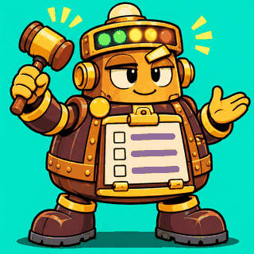<br>`shop-steward` | 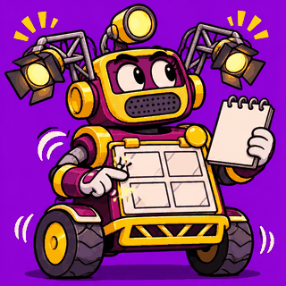<br>`creative-lead` | 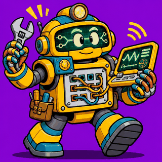<br>`technical-lead` | 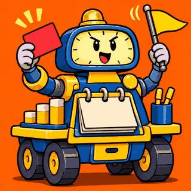<br>`production-lead` |
| 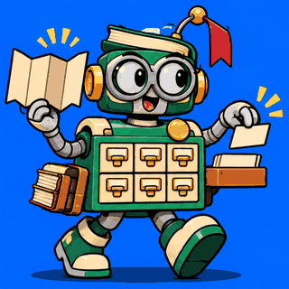<br>`knowledge-lead` |

**production**

| | | | |
|---|---|---|---|
| 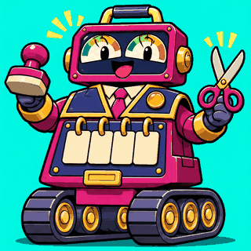<br>`producer` | 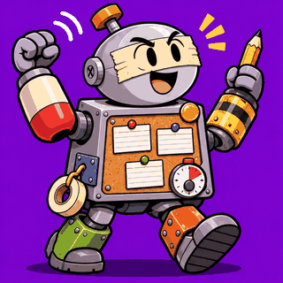<br>`prototyper` | 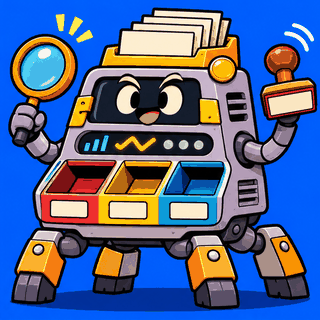<br>`qa-lead` | 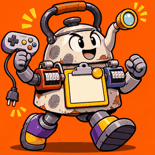<br>`qa-tester` |
| 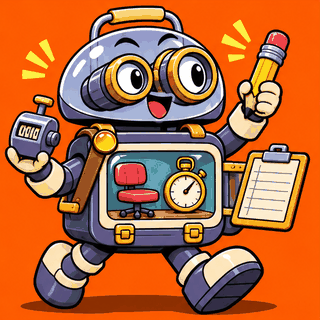<br>`playtest-analyst` | 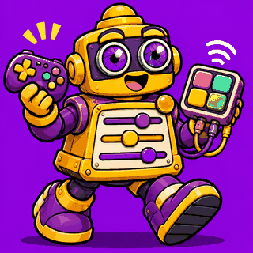<br>`accessibility-specialist` | 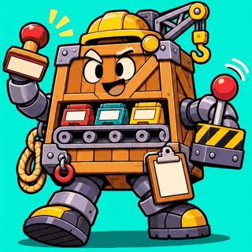<br>`release-manager` | 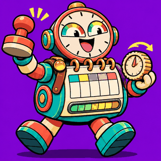<br>`live-ops-designer` |
| 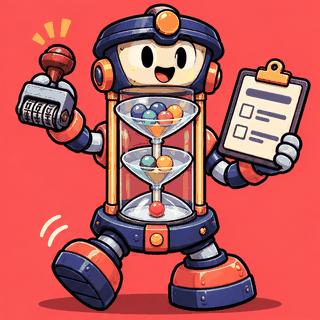<br>`analytics-engineer` | 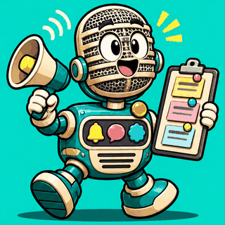<br>`community-manager` | 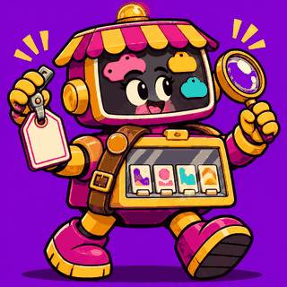<br>`store-page-marketer` | 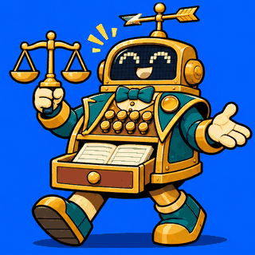<br>`monetization-designer` |
| 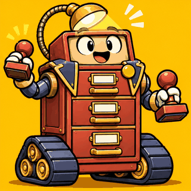<br>`game-legal-advisor` |

**creative/design**

| | | | |
|---|---|---|---|
| 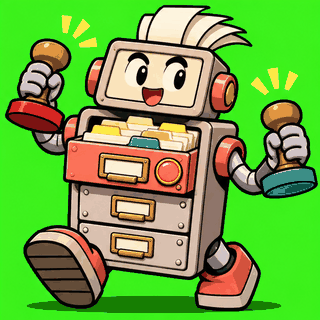<br>`brief-keeper` | 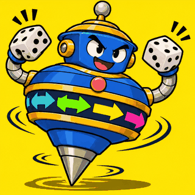<br>`game-designer` | 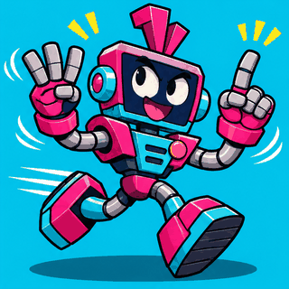<br>`controls-designer` | 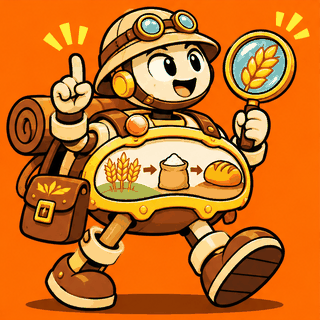<br>`world-builder` |
| 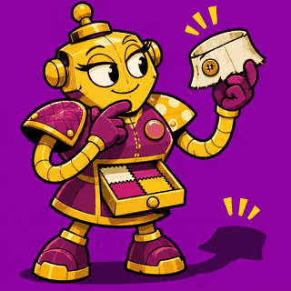<br>`character-designer` | 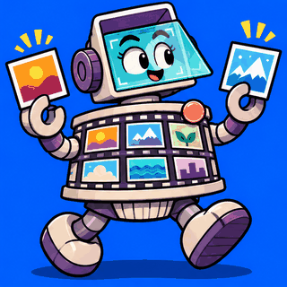<br>`moodboard-curator` | 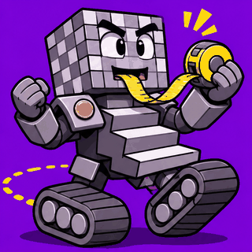<br>`level-designer` | 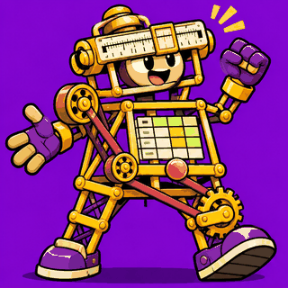<br>`systems-designer` |
| 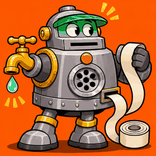<br>`economy-designer` | 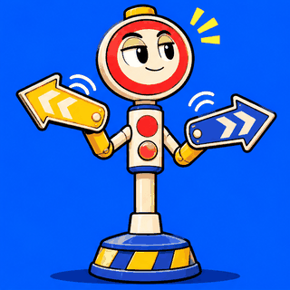<br>`ux-designer` | 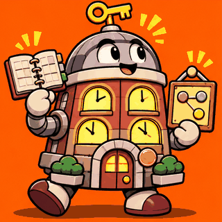<br>`npc-designer` | 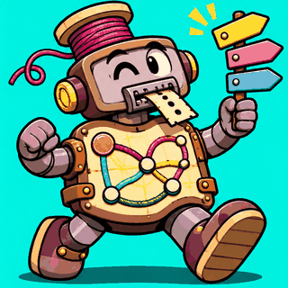<br>`quest-designer` |

**creative/art**

| | | | |
|---|---|---|---|
| 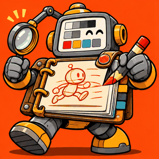<br>`art-director` | 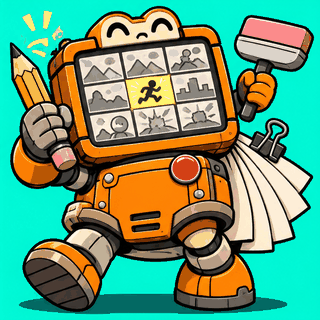<br>`concept-artist` | 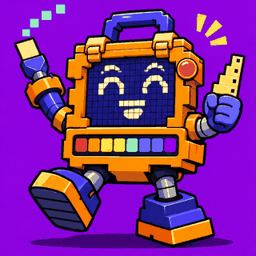<br>`sprite-artist` | 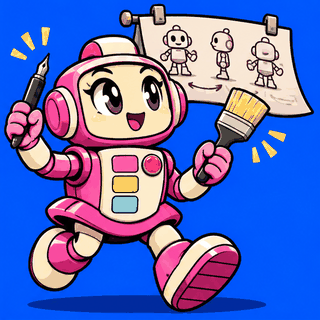<br>`anime-artist` |
| 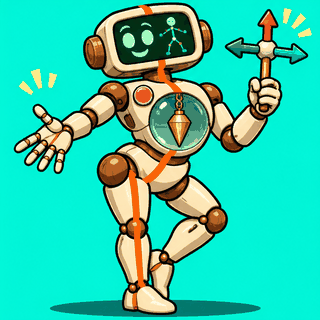<br>`pose-artist` | 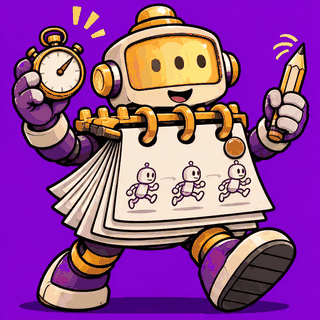<br>`animator` | 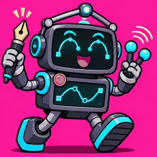<br>`vector-artist` | 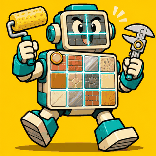<br>`texture-artist` |
| 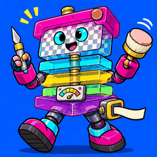<br>`layer-compositor` | 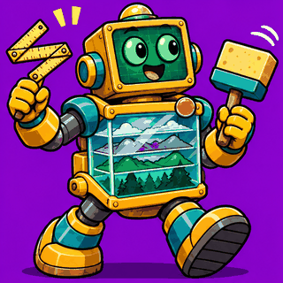<br>`environment-artist` | 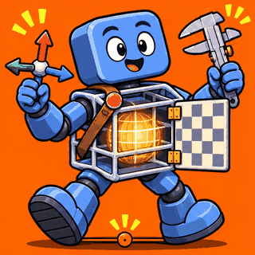<br>`modeler-3d` |

**creative/screens-effects**

| | | | |
|---|---|---|---|
| 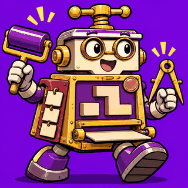<br>`logo-designer` | 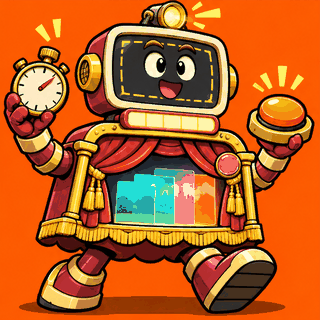<br>`title-screen-designer` | 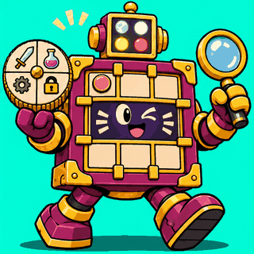<br>`game-ui-artist` | 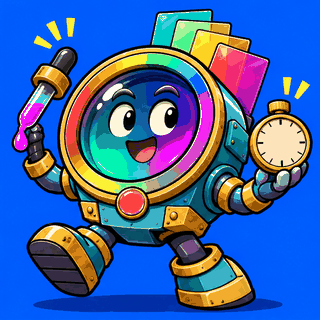<br>`shader-artist` |
| 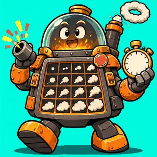<br>`vfx-artist` | 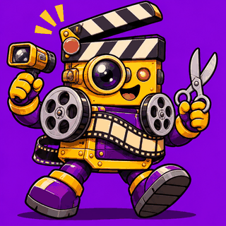<br>`video-director` |

**creative/sound**

| | | | |
|---|---|---|---|
| 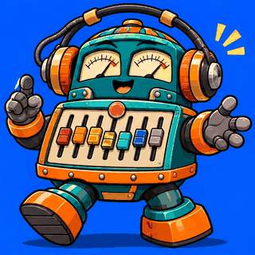<br>`audio-director` | 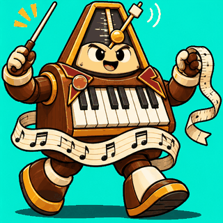<br>`composer` | <br>`sfx-designer` | <br>`chiptune-synthesist` |
| <br>`voice-director` |

**creative/narrative**

| | | | |
|---|---|---|---|
| <br>`narrative-director` | <br>`dialogue-writer` | <br>`lore-keeper` | <br>`localization-lead` |

**technical/programming**

| | | | |
|---|---|---|---|
| <br>`technical-director` | <br>`gameplay-programmer` | <br>`engine-programmer` | <br>`graphics-programmer` |
| <br>`physics-programmer` | <br>`ui-programmer` | <br>`tools-programmer` | <br>`technical-artist` |
| <br>`performance-engineer` | <br>`build-engineer` | <br>`save-systems-engineer` |

**technical/engines**

| | | | |
|---|---|---|---|
| <br>`web-engine-specialist` | <br>`godot-specialist` | <br>`unity-specialist` | <br>`unreal-specialist` |
| <br>`gamemaker-specialist` | <br>`roblox-specialist` | <br>`bevy-specialist` |

**technical/multiplayer**

| | | | |
|---|---|---|---|
| <br>`netcode-architect` | <br>`multiplayer-backend-engineer` | <br>`web-realtime-engineer` | <br>`matchmaking-engineer` |
| <br>`anti-cheat-engineer` |

**technical/ai-integration**

| | | | |
|---|---|---|---|
| <br>`ai-integration-architect` | <br>`llm-npc-engineer` | <br>`game-ai-engineer` | <br>`on-device-ai-engineer` |
| <br>`prompt-engineer` | <br>`rag-engineer` | <br>`ai-cost-safety-engineer` | <br>`procedural-generation-engineer` |

**technical/platform-tools**

| | | | |
|---|---|---|---|
| <br>`mcp-specialist` | <br>`agent-tooling-engineer` | <br>`game-security-engineer` |

**technical/asset-scouts**

| | | | |
|---|---|---|---|
| <br>`itch-scout` | <br>`unity-store-scout` | <br>`unreal-fab-scout` | <br>`godot-asset-scout` |
| <br>`open-asset-scout` | <br>`audio-asset-scout` | <br>`asset-license-auditor` |

**knowledge/genres**

| | | | |
|---|---|---|---|
| <br>`shooter-expert` | <br>`battle-royale-expert` | <br>`platformer-expert` | <br>`metroidvania-expert` |
| <br>`rpg-expert` | <br>`roguelike-expert` | <br>`strategy-expert` | <br>`city-builder-expert` |
| <br>`survival-crafting-expert` | <br>`puzzle-expert` | <br>`racing-expert` | <br>`fighting-expert` |
| <br>`horror-expert` | <br>`rhythm-expert` | <br>`visual-novel-expert` | <br>`mmo-expert` |
| <br>`sports-game-expert` | <br>`tower-defense-expert` | <br>`idle-incremental-expert` | <br>`party-game-expert` |

**knowledge/art-styles**

| | | | |
|---|---|---|---|
| <br>`pixel-art-stylist` | <br>`low-poly-stylist` | <br>`voxel-stylist` | <br>`hand-drawn-stylist` |
| <br>`anime-cel-stylist` | <br>`photoreal-stylist` | <br>`neon-vector-stylist` | <br>`toon-stylist` |
| <br>`ps1-retro-stylist` | <br>`paper-craft-stylist` | <br>`painterly-stylist` | <br>`isometric-stylist` |
| <br>`monochrome-noir-stylist` |

**knowledge/domains**

| | | | |
|---|---|---|---|
| <br>`nasa-data-specialist` | <br>`space-science-expert` | <br>`orbital-mechanics-expert` | <br>`space-apps-specialist` |
| <br>`healthcare-expert` | <br>`business-finance-expert` | <br>`education-expert` | <br>`climate-earth-expert` |
| <br>`law-civics-expert` | <br>`history-expert` | <br>`defense-strategy-expert` | <br>`sports-science-expert` |
| <br>`agriculture-food-expert` | <br>`cybersecurity-expert` | <br>`biology-ecology-expert` | <br>`physics-engineering-expert` |
| <br>`urban-planning-expert` |

## Contributing

New specialists are welcome. Run `/npc-union:new-specialist <topic>` to draft one, then follow [CONTRIBUTING.md](CONTRIBUTING.md). Please read the [Code of Conduct](CODE_OF_CONDUCT.md) and report security issues as described in [SECURITY.md](SECURITY.md).

## Licence

MIT. See [LICENSE](LICENSE) and [THIRD_PARTY_NOTICES.md](THIRD_PARTY_NOTICES.md).
