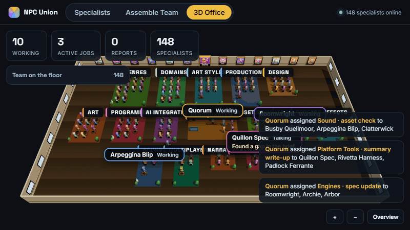
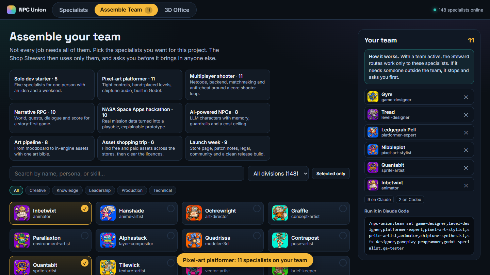
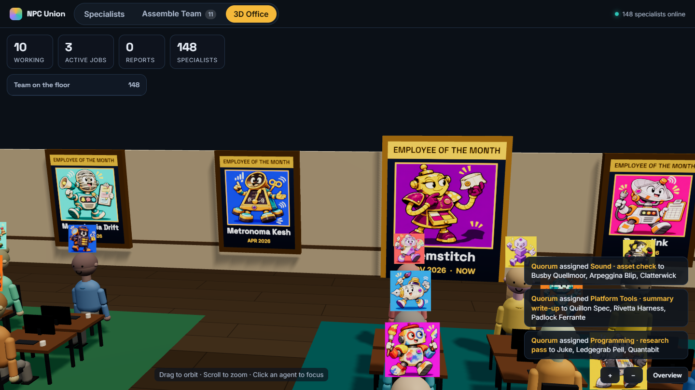
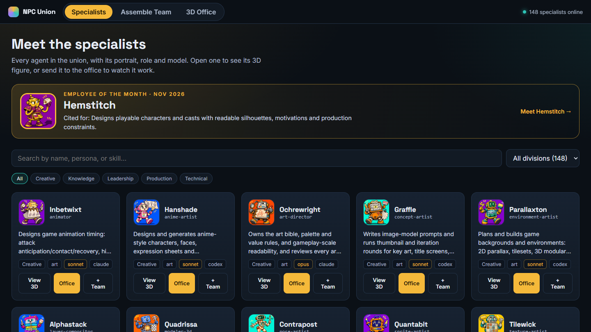

<h1 align="center">NPC Union</h1>

<p align="center"><b>An entire game studio, on call. One orchestrator conducts 148 specialists across Claude Code and Codex CLI.</b></p>

<p align="center">
  
  
  
  
  
</p>

<p align="center"></p>

<p align="center"></p>
<p align="center"><sub>The 3D office, recorded from this repo. Specialists work, confer, then walk their findings to the Shop Steward at the centre of the floor.</sub></p>

## What it is

NPC Union is a Claude Code plugin that turns a single prompt into a coordinated studio: **148 specialists in five divisions** (creative, technical, knowledge, production, leadership), spanning design, art, 3D, sound, narrative, engines, netcode, AI integration, asset scouting, genre and art-style mastery, and real-world domains from space science to healthcare.

You talk to one orchestrator, the **Shop Steward**. It reads the request, convenes only the specialists it needs, runs them in parallel where it can, and returns a single answer that credits who said what, flags conflicts between them, and keeps unverified claims marked. You can also talk to any specialist directly.

Every specialist has a persona, a cartoon portrait, a model, a runtime, owned skills, and a place in a cited, dated knowledge base. Agents look up version-specific facts instead of recalling them.

## Best with Claude Code and Codex CLI together

NPC Union is engineered as a dual-engine system, and it performs best when **Claude Code and Codex CLI work together and split the tasks between them**.

| Engine | Carries | Agents |
|---|---|---|
| **Claude Code** | Reasoning, design, code, review, orchestration | 95 run as native subagents |
| **Codex CLI** | Live web search, image generation, bulk drafting and fact-checking | 53 run through [`scripts/run-agent.mjs`](scripts/run-agent.mjs) |

The Steward decomposes each request across both engines: Claude agents reason and review while Codex agents fetch, generate and verify in parallel, each drawing on its own quota. A built-in **Budget Keeper** watches usage on both sides and advises on effort and model fit before heavy plans. Claude Code alone works too: Codex agents fall back to `claude -p` with a notice, though image generation needs Codex.

## Assemble your team

You rarely need all 148. Pick the specialists for the job and the Steward works from that short list.

<p align="center"></p>

- **Build it in the browser** (Assemble Team tab) from nine starter teams or card by card, then copy the command or download `team.json`.
- **Or in Claude Code:** `/npc-union:team set game-designer,sprite-artist,composer`, or `/npc-union:team preset pixel-platformer`.
- **The rule:** with a team active the Steward uses *only* those agents. If the work needs someone outside it, the Steward stops, names who and why, and asks you first. A yes covers that agent for that task only.
- The team lives in your project at `.npc-union/team.json`, and `node scripts/team.mjs check <agent>` enforces it by script instead of by memory. Details: [How it works](docs/HOW-IT-WORKS.md#teams).

## Install

In Claude Code:

```
/plugin marketplace add MaanasEgamamidi/NPC-Union
/plugin install npc-union@npc-union
```

Then start a session with the Steward:

```bash
claude --agent npc-union:leadership:shop-steward
```

No plugin system? `install.sh` (macOS, Linux) and `install.ps1` (Windows) copy the agents into a project's `.claude/` or your `~/.claude/`. See [CONTRIBUTING.md](CONTRIBUTING.md) for running from a clone.

```
> /npc-union:steward I want a pixel-art metroidvania in Godot. Where do I start?

Shop Steward: Three people on this one. Summary first, then who said what.

1. Lock the ability-gate graph before drawing a single room. (metroidvania-expert)
2. Pick a base resolution and tile size now; changing them later means redrawing
   every tileset. Scale by whole numbers only. (pixel-art-stylist)
3. Check the current Godot release before setting up the project, and turn on
   pixel snapping in project settings. (godot-specialist, version looked up
   from the official docs)

Next step: game-designer drafts the core loop. Want me to run it?
```

| Command | What it does |
|---|---|
| `/npc-union:steward` | Bring in the Shop Steward |
| `/npc-union:team <set\|add\|remove\|preset\|show\|clear>` | Assemble the team the Steward may use |
| `/npc-union:talk <agent>` | Talk to one specialist in character |
| `/npc-union:route` | Ask who should handle a request, without running anyone |
| `/npc-union:build-pipeline <idea>` | Get a written plan of which agents run in which order |
| `/npc-union:roster` | Browse agents by folder, capability, or runtime |
| `/npc-union:kb <query>` | Search the knowledge base |
| `/npc-union:new-specialist <topic>` | Generate a new specialist |

## The 3D studio

Every agent has a 3D figure, and the whole union runs in a live office you can open in a browser. No build step, no install.

```bash
python -m http.server 8000      # from the repo root, then open http://localhost:8000/office3d/
```

<table>
<tr>
<td width="50%"></td>
<td width="50%"></td>
</tr>
</table>

- **Floor plan by department**, with Headquarters and the Shop Steward at the centre, so every report is a short walk.
- **Live simulation:** assignments appear in the feed, partners confer across desks, and reporters walk to the Steward and back.
- **Employee of the Month:** a hall of fame along the north wall. Click any portrait to open that specialist's profile and spin their 3D figure. The winner is deterministic, so the same month crowns the same specialist for everyone.
- **Specialists, Assemble Team, 3D Office** tabs. Your team carries into the office, where only your team gets work.
- Re-record the GIF and screenshots any time with `node scripts/record-office.mjs` (needs Chrome or Edge, and ffmpeg).

## How it works

```
you
 └─ Shop Steward ── Budget Keeper (usage and effort advice)
     ├─ Creative Lead    → design · art · screens & effects · sound · narrative
     ├─ Technical Lead   → programming · engines · multiplayer · AI integration · platform tools · asset scouts
     ├─ Production Lead  → production
     └─ Knowledge Lead   → genres · art styles · domains
```

Agents live in `agents/<division>/<department>/<name>.md` and register as `npc-union:<division>:<department>:<name>`. The Steward routes from a generated catalog ([`catalog/CATALOG.md`](catalog/CATALOG.md)), hands cross-department work to a division lead, and checks each agent's `runtime` before running it. More: [HOW-IT-WORKS](docs/HOW-IT-WORKS.md), [PIPELINE](docs/PIPELINE.md), [agent schema](docs/AGENT-SCHEMA.md).

| Division | Agents |
|---|---|
| Creative | 38 |
| Technical | 41 |
| Knowledge | 50 |
| Production | 13 |
| Leadership | 6 |

The full list with portraits is in [docs/ROSTER.md](docs/ROSTER.md).

## Contributing

New specialists are welcome. Run `/npc-union:new-specialist <topic>` to draft one, then follow [CONTRIBUTING.md](CONTRIBUTING.md). Checks: `node scripts/validate.mjs --strict` and `node --test tests/*.test.mjs`. Please read the [Code of Conduct](CODE_OF_CONDUCT.md) and report security issues as described in [SECURITY.md](SECURITY.md).

## Licence

MIT. See [LICENSE](LICENSE) and [THIRD_PARTY_NOTICES.md](THIRD_PARTY_NOTICES.md).
